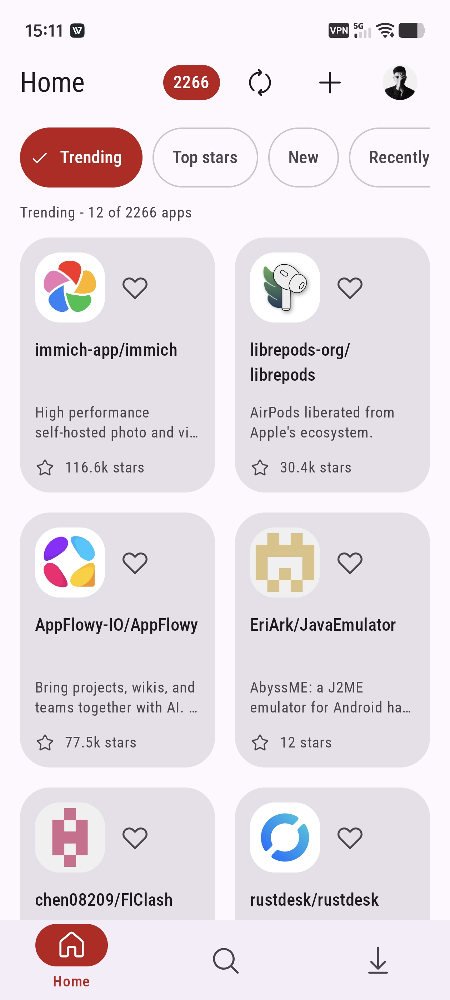
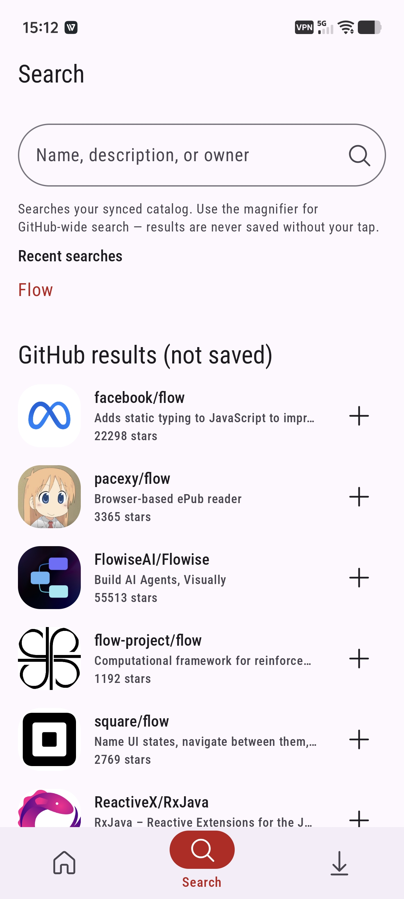
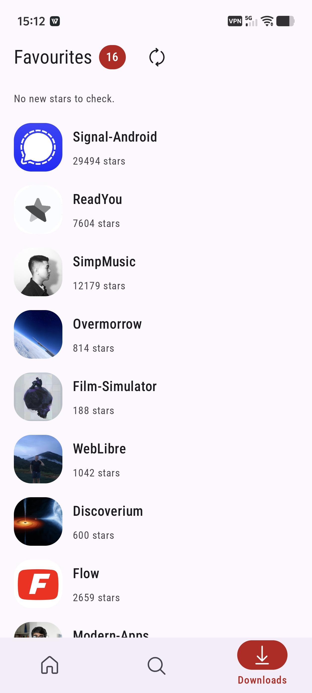
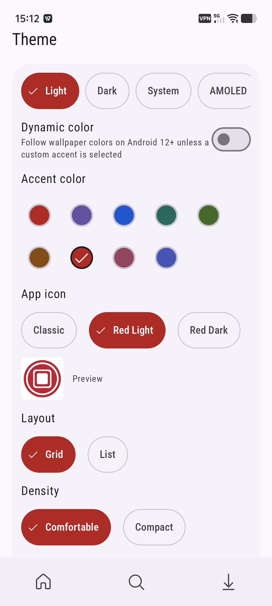

# G Store

Discover Android apps shared through GitHub Releases. Browse, search, save favorites, and download APKs directly from their source repositories.

[Download the latest release](https://github.com/ngocthanhgl/G-Store/releases/latest)

<table>
  <tr>
    <td align="center"> Home</td>
    <td align="center"> Search</td>
  </tr>
  <tr>
    <td align="center"> Downloads &amp; favorites</td>
    <td align="center"> Appearance</td>
  </tr>
</table>

APK availability and compatibility depend on each project's published releases. Apps and repository artwork belong to their respective authors.
