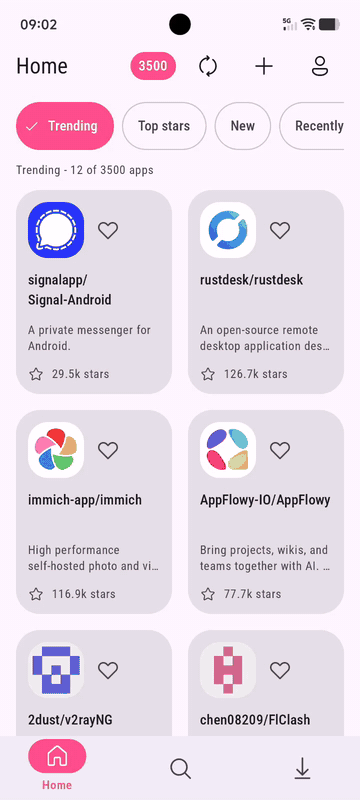
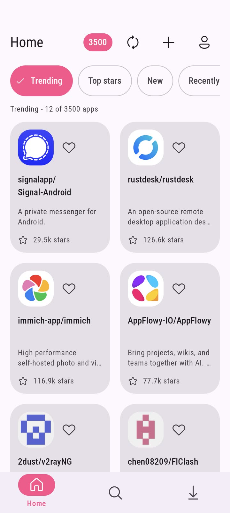
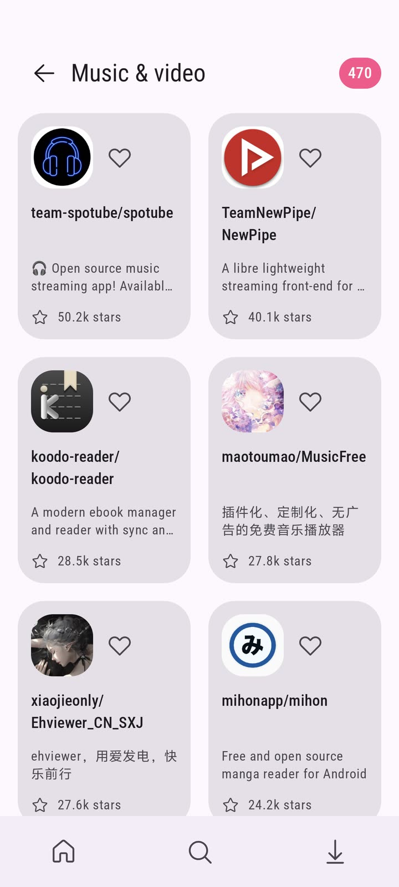
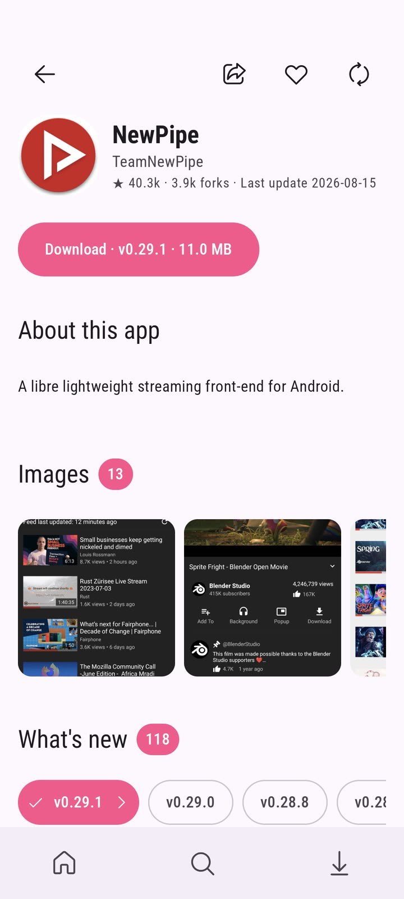

<p align="center">
  <picture>
    <source media="(prefers-color-scheme: dark)" srcset="assets/logo/logo-lockup-dark.png">
    
  </picture>
</p>

<p align="center">
  A native Android storefront for apps published as GitHub releases.<br>
  Discover a project, read its README, pick the right APK, install from the original source.
</p>

<p align="center">
  
  
  
  
</p>

<p align="center">
  
</p>

[Download the latest release](https://github.com/ngocthanhgl/forkly/releases/latest)

## Discover apps

Browse the catalog by **Trending**, **New**, **Top stars**, or **Recently updated**. Explore topic-based categories, keep a favorites list, search the catalog, or search GitHub and add a repository yourself.

The catalog scanner runs on a schedule and rotates across app types, technologies, and popularity ranges. GitHub does not provide a complete index of every repository with an APK, so coverage is best-effort; add a repository if the scan missed it.

## Choose, download, install

App pages include repository details, release history and notes, the project README rendered from its real Markdown, and available APK artifacts. Compare file size and ABI information when available, then download with background progress and cancellation. Installation is handed off to Android's system installer.

Stable releases are preferred; prereleases are identified separately. APKs and repository metadata come from their maintainers and are not security-reviewed by Forkly. Review the source before installing.

## Make it yours

Choose light, dark, system, or AMOLED themes; set an accent color, grid or list layout, card density, card shape, reduced motion, and home-section order.

## Screenshots

<table>
  <tr>
    <td align="center"><br><sub>Home — trending, new, top stars</sub></td>
    <td align="center"><br><sub>Categories</sub></td>
    <td align="center"><br><sub>App details, notes, artifacts</sub></td>
  </tr>
</table>

APK availability and device compatibility depend on each project's releases. Repository names, artwork, and APKs remain the property and responsibility of their respective maintainers.

## Build

Requirements: JDK 21+ (JDK 25 is used in CI), Android SDK with API 37.

```bash
git clone https://github.com/ngocthanhgl/forkly.git
cd forkly
./gradlew :app:assembleDebug
```

Release builds are signed in CI from repository secrets and published on `v*` tags. See `.github/workflows/release.yml`.

## Project docs

- [Brand guide](BRAND.md)
- [Product spec](docs/PRODUCT_SPEC.md)
- [Architecture](docs/ARCHITECTURE.md)
- [Dataflow](docs/DATAFLOW.md)
- [Security model](docs/SECURITY_MODEL.md)
- [Android permissions](docs/ANDROID_PERMISSIONS.md)
- [GitHub discovery](docs/GITHUB_DISCOVERY.md)
- [Test plan](docs/TEST_PLAN.md)
- [Decisions](docs/DECISIONS.md)

## License

Forkly is free software under the [GNU General Public License v3.0](LICENSE).

Forkly is an independent project and is not affiliated with, endorsed by or sponsored by GitHub, Inc. "GitHub" is used descriptively only.
