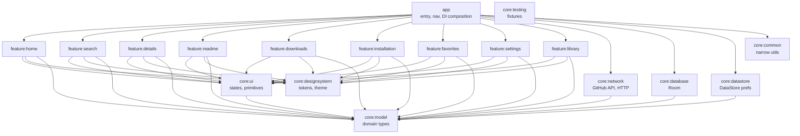

# ARCHITECTURE — G Store

Status: Milestone 0 proposal. Module boundaries confirmed here; do not create
modules beyond this list without updating this doc (ponytail: smallest set first).

Interactive diagram: `../.archify/architecture-gstore-20261010-120000/gstore-architecture.html`
(archify `finalize`, showcase profile; system overview of the main journey).

## 1. Module map (Gradle modules, created at Milestone 2)

Milestone 2 starts with `app + core:model + core:ui + core:designsystem + core:common`
and adds `core:network/database/datastore` + features only when their contracts
are stable. Never create a module for a single class.

## 2. Dependency rules (enforced by review; module-private internals)

1. UI depends on domain interfaces + immutable UI state only.
2. Domain logic never touches Compose, Activity, or concrete HTTP clients.
3. Data implementations expose repository interfaces to domain.
4. Features never import another feature's private implementation.
5. Shared infra never depends on features.
6. Installation behavior hides behind `InstallerGateway` (platform abstraction).
7. No global mutable state, no service locators, no god ViewModels.

## 3. Patterns

- Offline-first: Room is the single source of truth; UI observes `Flow`;
  network refreshes write through the DB (see DATAFLOW.md flow F).
- DI: constructor injection via Hilt; documented in `app` composition root.
- Concurrency: Kotlin coroutines + structured concurrency; bounded parallelism
  for discovery (`Semaphore(4)`); request dedup by repo ID in flight map.
- Errors: sealed `Result`/`CatalogFailure` types (see DATA_MODEL.md); every
  screen models loading/error/empty/refresh states explicitly.
