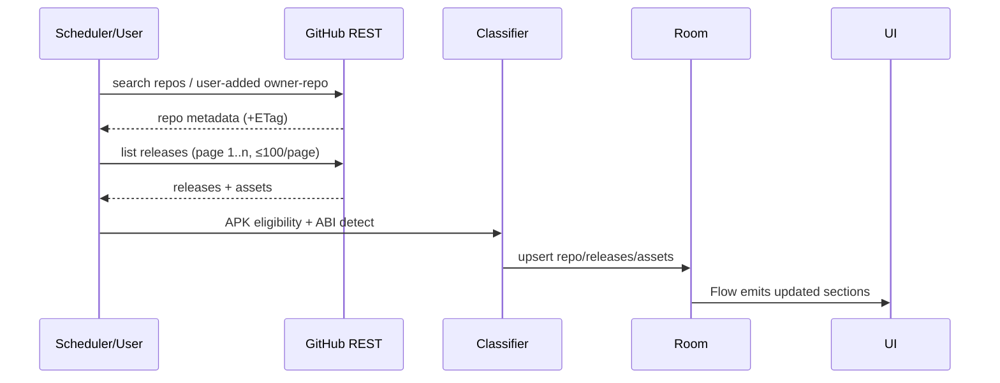

# DATAFLOW — G Store

Normal + failure paths for the six principal flows. Single source of truth:
Room for catalog state, DataStore for preferences, app-specific files for APKs.

## Flow A — Discovery

Failures: 403/429 → honor `Retry-After`, exponential backoff + jitter, checkpoint
persisted, resume from last page; 404/451 → mark repo inaccessible, keep stale
cache with "stale" flag; malformed JSON → drop page, log, continue; no network →
serve cache, banner "offline".

## Flow B — README

Selection → resolve default branch (`GET /repos/{o}/{r}` → `default_branch`) →
try `README.md` name conventions via contents API (`readme` endpoint preferred) →
fetch Markdown source → bounded cache (≤2 MB/doc, LRU 200 docs) → parse with
maintained Kotlin parser → sanitized Compose model → render. Relative links and
images resolved against `raw.githubusercontent.com/{o}/{r}/{branch}/`.
Failures: missing README → empty state; oversized → truncated with notice;
unsupported HTML → stripped, content kept; private-network URLs → never fetched.

## Flow C — Download

Select artifact → validate metadata (size>0, URL host allowlist) → user confirm →
enqueue (idempotent per asset ID; duplicate → return existing task) → background
worker with progress/cancel → temp `.part` file → size check → SHA-256 verify if
trusted digest → APK structural check (ZIP + `AndroidManifest.xml` present) →
atomic rename → history record. Failures: expired URL → refresh asset metadata
once, then fail visibly; storage exhaustion → pre-check + mid-write catch, cleanup
`.part`; network loss → retry recoverable only (5xx/timeout), never 4xx.

## Flow D — Installation

Completed APK → re-validate → `canRequestPackageInstalls()`? → if no, explanatory
screen → user taps → `ACTION_MANAGE_UNKNOWN_APP_SOURCES` settings → re-check on
return → `ACTION_VIEW` + FileProvider URI (`application/vnd.android.package-archive`,
`FLAG_GRANT_READ_URI_PERMISSION`) → system installer UI → report outcome only as
observed (never claim success without evidence). Never silent-install.

## Flow E — Preferences

Change → validate range → DataStore write → `SettingsState` update → theme/layout
re-compose → survives process death (read at startup before first frame).

## Flow F — Offline-first UI

DB + prefs → immediate cached frame → background refresh → DB update → UI
re-emit. Network never blocks first paint; every list carries freshness timestamp.
